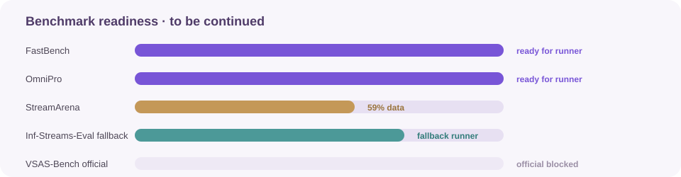

# 📊 GAMST Bench

**Real-time perception for existing LLMs, at a fraction of VLM cost.**

A **context-pipeline benchmark**: does an existing LLM, given Gamst's lightweight perception plus selective VLM calls, still receive grounded, on-time evidence, and how much cheaper is that than running a VLM on every frame?

**[Dashboard](https://gamst-bench.jinminseong.com)** · [Evaluation protocol](docs/PROTOCOL.md) · [Runbook](docs/RUNBOOK.md) · [Annotation guidelines](docs/ANNOTATION.md) · [Adapter contract](docs/ADAPTERS.md)

> The public release contains 36 synthetic scenarios × 13 configurations (five matched arms A–E plus eight VLM-budget sweep points): 468 protocol-validation runs. These are not real model inference, physical-sensor experiments, or an eight-hour soak. Sample results do not establish quality preservation or cost savings.

<a id="contents"></a>
## 🗂️ Contents

[🚦 Current status](#status) · [🎯 Evaluation scope](#evaluation) · [🔌 Evaluation MCP](#multi-benchmark-mcp) · [☁️ GCP workflow](#gcp-workflow)<br>
[🧭 Benchmark atlas](#benchmark-atlas) · [📊 Public results](#benchmark-results) · [🛠️ Local development](#development) · [🧪 Reproduction](#reproduce)<br>
[📤 Publish evidence](#publish) · [📏 Acceptance criteria](#acceptance) · [🚀 Deployment](#deployment) · [📚 References](#references)

<a id="status"></a>
## 🚦 Implementation and measurement status

**Implementation completion and evaluation completion are separate milestones.** Model execution and benchmark dataset downloads take place on GCP only.

- [x] Cross-filtering dashboard and synchronized README results.
- [x] MCP catalog with ten total recipe records: seven executable recipes across four runnable families (FastBench, OmniPro, StreamArena and the separately labelled Inf-Streams-Eval fallback) plus three reference-only records; asynchronous execution, cancellation and log inspection are implemented.
- [x] Checks for GCP project identity, pinned code revisions and dataset hashes, plus GPU resource logging.
- [x] Tests for MCP communication, execution refusal and failure handling, plus [GitHub CI](https://github.com/NomaDamas/Gamst-bench/actions).
- [x] MCP/GCP setup and private remote handshake were verified through the Aside setup; native benchmark execution remains pending.
- [x] GCP dataset preparation: FastBench and OmniPro are complete on the persistent disk; StreamArena metadata is complete and 203/243 video archives are in GCS.
- [ ] Dataset access approval, pinned models/data and small-scale execution checks.
- [ ] Gamst-specific model/agent adapters and real compatibility validation for each benchmark.
- [ ] Full measured runs, independent scoring, event-response latency and full-pipeline cost verification.
- [ ] Publication of reviewed results and compliance with each official leaderboard’s submission requirements.

Current public figures are **synthetic protocol checks**. Published reference numbers, directly reproduced official scores and Gamst extension results remain separate. Gamst superiority has not been established.

**Live preparation snapshot (2026-11-18):** `gamst-bench-gpu` is `TERMINATED`; no GPU runtime is running. StreamArena transfer is active on the workstation at 203/243 video archives; its full manifest will be frozen after completion. The 200GB persistent disk and GCS objects continue to incur storage charges.

### ✅ Selected evaluation set

The first measured campaign uses **GAMST Bench 자체 평가 + FastBench + OmniPro + StreamArena**. Inf-Streams-Eval is retained as a separate long-session fallback for the blocked VSAS track. SPOT-Bench, OVO-Bench, StreamingBench and OmniVideoBench remain optional supporting checks.


<a id="evaluation"></a>
## 🎯 Evaluation scope

- **A:** VLM-centered processing. **B:** Lightweight perception only (text LLM, no VLM). **C:** Gamst hybrid with selective calls. **D:** Periodic hybrid using the same model. **E:** Small streaming VLM watching continuously (StreamingVLM-style), the strongest cheap alternative.
- Acceptance comparisons: **C vs A** (whole approach), **C vs D** (selection vs fixed schedule) and **C vs E** (Gamst vs a lightweight streaming VLM). Each is gated separately.
- **VLM budget sweep:** C and D also run at 1, 2, 3, 6 and 12 VLM calls per session (`role: sweep`). The curve shows the budget at which each policy reaches a given quality. Sweep points never enter acceptance.
- Evaluation unit: sensors + perception models + VLM + policy + memory + consumer LLM + hardware.
- Primary metric: **grounded, on-time success**. An answer must be correct, supported by semantically valid evidence and delivered within the deadline.
- Six suites: brief events / subtle semantic changes / object and state memory / audio–visual revisions / context retained before a query / interruption and overload recovery.
- Report full-pipeline cost, p95 answer latency, critical-fact recall, unsupported claims, stale-state errors, abstentions, false alerts per hour, memory and dropped inputs.
- Official-protocol scores from FastBench and other external benchmarks remain separate from Gamst’s aggregate evaluation.

### 🧩 Model and runtime settings

| Arm | Pipeline | Model setting | Status |
| --- | --- | --- | --- |
| A | Sensors → VLM → memory → consumer LLM | Same pinned VLM as C; checkpoint, precision, prompt and consumer revision are **TBD at GCP freeze** | to be continued |
| B | Sensors → thin perception → consumer LLM | No semantic VLM calls; thin perception/ASR revisions must be pinned | to be continued |
| C | Sensors → Gamst triggers → selective VLM → memory → consumer LLM | Candidate arm; matched VLM, memory, consumer, hardware and input track with A/D | to be continued |
| D | Sensors → periodic VLM → memory → consumer LLM | Same VLM as A/C; fixed schedule control | to be continued |
| E | Sensors → small always-on streaming VLM → memory → consumer LLM | Separate lightweight checkpoint; continuous 4Hz-style control | to be continued |

Synthetic fixture values such as `fixture-vlm` are protocol-validation placeholders and are not model settings or benchmark results.

<!-- MCP:START -->
<a id="multi-benchmark-mcp"></a>
## 🔌 Required benchmark MCP

Four required benchmark tracks: FastBench, OmniPro, StreamArena and VSAS-Bench. The catalog has 10 total recipe records: 7 executable recipes across four runnable families (including Inf-Streams-Eval as a VSAS-compatible fallback) and 3 reference-only records. VSAS-Bench itself remains **required but blocked pending its official runner/data/scorer release**.

[MCP tools and deployment guide](docs/MCP.md) · [Private GCP profile templates](mcp/profiles.example.json) · [SSH client example](mcp/client.ssh.example.json)

- **FastBench**: `fastbench-baseline`, `fastbench-proactive`.
- **OmniPro**: `omnipro-probe`, `omnipro-online`.
- **StreamArena**: `streamarena-offline`, `streamarena-continuous`.
- **Inf-Streams-Eval**: `infstreams-long`.
- **VSAS-Bench**: official track blocked; use `infstreams-long` only as a separately labelled fallback.

Tools cover catalog, readiness/plan hashes, GCP-only dataset download, asynchronous evaluation, cancellation, persistent status and native artifacts.

Dataset acquisition and inference remain GCP-only; no model or benchmark data is downloaded to the local workstation.

<!-- MCP:END -->

<a id="gcp-workflow"></a>
## ☁️ GCP evaluation workflow

1. **Prepare the environment:** verify the unique project ID, GPU, cost and stop policy for the authorized account’s `gamst` project. [GCP preparation](infra/gcp/README.md).
2. **Prepare data:** preserve original timestamps and AV synchronization; freeze access permissions, revisions, file hashes and session-level splits. Do not download datasets or models locally.
3. **Run the selected evaluation set:** Gamst self-evaluation → FastBench → OmniPro Probe/Online → StreamArena RTP/HR/Tool/Pro. Verify execution and scoring on a small development sample before a full run.
4. **Run the long-session fallback:** use Inf-Streams-Eval for sustained quality and resource behavior; report it separately from VSAS-Bench.
5. **Run optional supporting checks:** SPOT Detection, OVO, StreamingBench and OmniVideoBench only when their access and revision manifests are frozen.
6. **Evaluate Gamst-specific cases:** use separate held-out data for subtle OCR changes, audio corrections, sensor gaps, reappearing deleted memories and stale-state errors.
7. **Publish:** compare quality, cost and latency with matched models, hardware and consumer LLMs, then publish after independent review. [Comparison design](docs/COMPARISONS.md).

### 🔌 MCP connection and tools

Gamst’s **context-delivery MCP** and this repository’s **evaluation-execution MCP** are separate servers. [Gamst project](https://github.com/NomaDamas/Gamst) · [MCP guide](docs/MCP.md).

```bash
# Install MCP tooling only. No model weights or benchmark datasets are downloaded.
uv venv .venv-mcp --python 3.12
uv pip install --python .venv-mcp/bin/python -r requirements-mcp.txt
./scripts/serve-mcp.sh
```

Without a configuration, the server provides the catalog and registers no execution profiles. For real execution, connect to GCE using the [SSH client example](mcp/client.ssh.example.json) and [private configuration template](mcp/profiles.example.json). Templates remain disabled until reviewed.

- **Discovery:** `list_benchmarks`, `get_benchmark`, `list_profiles`.
- **Preparation:** `plan_dataset`, `prepare_dataset`, `plan_evaluation`.
- **Execution management:** `start_evaluation`, `list_runs`, `get_run`, `cancel_run`.
- **Artifacts:** `list_artifacts`, `read_artifact`.

Official scores retain their native scorers and metrics. GPU resource logs alone do not establish full cost or event-response latency, and execution completion is not an evaluation pass.


<!-- BENCHMARKS:START -->
<a id="benchmark-atlas"></a>
## 🧭 Benchmark atlas

Reviewed 2026-11-14. Published snapshots are **not reproduced**, not a live SOTA ranking and not comparable across protocols. Real Gamst runs remain **to be continued** until the frozen GCP model manifest and held-out split are executed.

[🖥️ Interactive benchmark site](https://gamst-bench.jinminseong.com/#benchmarks) · [Matched evaluation plan](docs/COMPARISONS.md) · [GCP preparation](infra/gcp/README.md)



### 🗂️ Benchmark index

| | Benchmark | What it asks | Data shape | Status |
| --- | --- | --- | --- | --- |
| ⚡ | [FastBench](#fastbench) | “지금 보이는 짧은 사건 뒤 3초 동안 무엇이 일어나는가?” | 300 videos · 306 QA · ~8.3 GiB | 데이터 준비 완료 · 공식 runner/실제 모델 평가 대기 |
| 🔔 | [SPOT-Bench](#spot) | “이 스트림에서 지금 알림해야 하는가, 침묵해야 하는가?” | 662 released videos · ~40 GB | 보조 대표 벤치 · access/runner 준비 대기 |
| 🔄 | [OVO-Bench](#ovo) | “현재 상태와 과거 근거를 연결해 다음 행동을 예측하는가?” | 644 videos · 3,100 queries | 보조 대표 벤치 · 데이터/runner 준비 대기 |
| 📺 | [StreamingBench](#streamingbench) | “긴 영상의 여러 시점 질문에 답하면서 context budget을 줄여도 이해가 유지되는가?” | 900 videos · 4,500 QA on project page | 보조 회귀 벤치 · 실제 revision freeze 대기 |
| 🎧 | [OmniPro](#omnipro) | “어떤 조건이 발생하면 언제 무엇을 말해야 하는가?” | 2,700 samples · 9 tasks | 데이터 준비 완료 · Probe/Online 실제 실행 대기 |
| 🧠 | [StreamArena](#streamarena) | “현재 장면, 과거 근거, 외부 도구, 미래 발화 시점을 어떻게 처리하는가?” | 3,646 questions in published v2 runs | GCS 전송 진행 중 203/243 tar · 메타데이터 완료 · 실제 실행 대기 |
| 🌊 | [Inf-Streams-Eval](#infstreams) | “긴 스트림에서 생성 품질과 자원 사용이 시간에 따라 유지되는가?” | Videos average over 2 hours | runner/scorer 확인 완료 · GCP 데이터 다운로드 및 manifest 대기 · VSAS 공식 점수와 분리 |
| 🎬 | [OmniVideoBench](#omnivideo) | “시청각 단서를 함께 사용해 질문과 reasoning을 해결하는가?” | 628 videos · 1,000 QA | 보조 AV 벤치 · access 승인 대기 |
| ⏱️ | [VSAS-Bench](#vsas) | “비동기 입력과 부하 속에서도 언제, 얼마나 정확하고 일관되게 응답하는가?” | 18,000+ annotations (paper) | 공식 트랙 blocked · 아래 Inf-Streams-Eval fallback과 Gamst self-eval로 준비 |
| 🧪 | [GAMST Bench 자체 평가](#gamst-bench-self-evaluation) | “같은 입력과 소비자 LLM에서 선택적 context가 정확도·지연·비용·안정성을 함께 개선하는가?” | 6 task suites · 5 matched arms | to be continued · real GCP model runs not started |

> 공식 점수와 Gamst 확장 점수는 같은 표에 합치지 않습니다. VSAS-Bench의 공식 트랙은 blocked 상태로 유지하고, 대체 트랙은 별도 이름으로 기록합니다.

### 🧭 Benchmark detail
<details id="fastbench">
<summary>⚡ <strong>FastBench</strong> · Public research · 2026</summary>

### ⚡ FastBench · Public research · 2026

[Official source](https://github.com/Ashone3/FastBench) · [Dataset](https://huggingface.co/datasets/Ashenone3/FastBench)

- **What it asks:** “지금 보이는 짧은 사건 뒤 3초 동안 무엇이 일어나는가?”
- **Abilities:** 순간 사건 감지 · temporal/state dynamics · deadline 준수
- **Data shape:** 300 MP4 clips + 306 timed QA; annotation은 video_path, 질문/초점/응답 시각, 기준 응답, capability/domain을 가진 JSON
- **Existing approach:** Incremental video, timed answers and ProactiveFrame adaptive FPS.
- **Gamst hypothesis:** Compare lightweight triggers and periodic audits at matched context budgets.
- **Metrics:** Official timed QA score
- **Model setup:** A/C/D는 동일한 고정 VLM; B는 thin perception; E는 small streaming VLM. FPS·prompt·judge를 공식 preset에 고정
- **Preparation:** Preserve MP4 FPS and clip timestamps; pin annotation, judge and official preset.
- **Status:** 데이터 준비 완료 · 공식 runner/실제 모델 평가 대기
- **Limits:** Video time is not wall-clock inference latency. Annotated focus times are oracle-only. Code MIT does not license the videos.

- Published: **Qwen3-VL-8B · 2 FPS — 32.9% Official timed QA score**. Manuscript baseline; not reproduced here. [Source](https://github.com/Ashone3/FastBench).
- Published: **Qwen3-VL-8B + ProactiveFrame — 38.3% Official timed QA score**. Manuscript adaptive-frame preset; not reproduced here. [Source](https://github.com/Ashone3/FastBench).

</details>

<details id="spot">
<summary>🔔 <strong>SPOT-Bench</strong> · NeurIPS 2026 · E&D</summary>

### 🔔 SPOT-Bench · NeurIPS 2026 · E&D

[Official source](https://dibschat.github.io/SPOT-Bench/) · [Dataset](https://huggingface.co/datasets/cvml-nus/spot-bench)

- **What it asks:** “이 스트림에서 지금 알림해야 하는가, 침묵해야 하는가?”
- **Abilities:** timeliness · false alerts · duplicate suppression
- **Data shape:** 662 visual videos + 1Hz stream annotations; audio 제거 Detection release
- **Existing approach:** Timeliness-F1 scores every prediction across the stream.
- **Gamst hypothesis:** Measure missed events, duplicate alerts and unnecessary consumer calls.
- **Metrics:** Detection T-F1@5 · 1Hz
- **Model setup:** Ctrl-SPOT/native runner와 Gamst trigger를 separate protocol로 보고
- **Preparation:** Request source Ego4D/Ego-Exo4D access and accept HF conditions; start with full Detection release.
- **Status:** 보조 대표 벤치 · access/runner 준비 대기
- **Limits:** Visual-only, audio removed. Interaction/Intervention release is validation-only. CC BY-NC-SA and source conditions apply.

- Published: **Ctrl-SPOT — 20.9% Detection T-F1@5 · 1Hz**. Published Detection leaderboard snapshot. [Source](https://dibschat.github.io/SPOT-Bench/).
- Published: **JoyAI-VL-Interaction — 16.3% Detection T-F1@5 · 1Hz**. Published Detection leaderboard snapshot. [Source](https://dibschat.github.io/SPOT-Bench/).
- Published: **MiniCPM-o 4.5 — 14.9% Detection T-F1@5 · 1Hz**. Published Detection leaderboard snapshot. [Source](https://dibschat.github.io/SPOT-Bench/).

</details>

<details id="ovo">
<summary>🔄 <strong>OVO-Bench</strong> · CVPR 2025</summary>

### 🔄 OVO-Bench · CVPR 2025

[Official source](https://github.com/JoeLeelyf/OVO-Bench) · [Dataset](https://huggingface.co/datasets/JoeLeelyf/OVO-Bench)

- **What it asks:** “현재 상태와 과거 근거를 연결해 다음 행동을 예측하는가?”
- **Abilities:** current state · backward tracing · forward response · memory
- **Data shape:** 644 videos + 3,100 queries; source archive 또는 official chunked videos
- **Existing approach:** Real-time perception, backward tracing and forward active responding.
- **Gamst hypothesis:** Test context retention, current versus last-seen state and causal delivery.
- **Metrics:** Official per-task / per-mode scores
- **Model setup:** 공식 offline/online mode를 분리하고 Qwen2VL revision을 고정
- **Preparation:** Use ~44 GB source archive plus official chunker, or ~144 GB pre-chunked archives; pin release.
- **Status:** 보조 대표 벤치 · 데이터/runner 준비 대기
- **Limits:** Published and revised code protocols differ. CC BY-NC-SA and source licenses apply. No verified score imported in this catalog.

No verified numeric result imported.

</details>

<details id="streamingbench">
<summary>📺 <strong>StreamingBench</strong> · Public benchmark</summary>

### 📺 StreamingBench · Public benchmark

[Official source](https://streamingbench.github.io/) · [Dataset](https://huggingface.co/datasets/mjuicem/StreamingBench)

- **What it asks:** “긴 영상의 여러 시점 질문에 답하면서 context budget을 줄여도 이해가 유지되는가?”
- **Abilities:** general video QA · audio/context understanding
- **Data shape:** project page 기준 900 videos + 4,500 QA; task별 question JSON과 영상
- **Existing approach:** 18 tasks with questions at multiple video timestamps.
- **Gamst hypothesis:** Check that cheaper context does not degrade general understanding.
- **Metrics:** Overall accuracy
- **Model setup:** native MiniCPM-V baseline과 Gamst matched arm을 별도 실행; 60s context와 all-context를 구분
- **Preparation:** Download official videos and QA on GCP; reconcile actual revision counts before freezing.
- **Status:** 보조 회귀 벤치 · 실제 revision freeze 대기
- **Limits:** Posted results mostly use older model versions and different frame budgets; not a current universal SOTA.

- Published: **Gemini 1.5 Pro — 70.26% Overall accuracy**. Official site historical overall table; video input. [Source](https://streamingbench.github.io/).
- Published: **MiniCPM-o 2.6 — 66.01% Overall accuracy**. Official site historical overall table; 60 frames. [Source](https://streamingbench.github.io/).

</details>

<details id="omnipro">
<summary>🎧 <strong>OmniPro</strong> · Preprint · 2026</summary>

### 🎧 OmniPro · Preprint · 2026

[Official source](https://github.com/RuixiangZhao/OmniPro) · [Dataset](https://huggingface.co/datasets/RuixiangZhao/OmniPro)

- **What it asks:** “어떤 조건이 발생하면 언제 무엇을 말해야 하는가?”
- **Abilities:** audio-visual fusion · alerting · grounding · counting · monitoring · narration · prediction
- **Data shape:** 1,262 MP4 + benchmark.json 2,700 rows/9 tasks; 각 row에 question_time, audio_dependency, trigger_time, response, trigger_type이 있음
- **Existing approach:** Probe tests pre/post event understanding; Online tests timing and content jointly.
- **Gamst hypothesis:** Compare audio-only, vision-only and fused context; retain non-speech evidence.
- **Metrics:** Probe paired accuracy / Online F1
- **Model setup:** Probe와 Online을 분리. vision-only/audio-only/fused ablation을 별도 실행하며 native model, tolerance ±3s, judge revision을 고정
- **Preparation:** Keep raw video/audio and trigger labels; implement a persistent begin/observe/end adapter.
- **Status:** 데이터 준비 완료 · Probe/Online 실제 실행 대기
- **Limits:** 84% audio dependency. Probe and Online are distinct leaderboards. Preserve official matching tolerance and judge.

- Published: **Gemini-3-Flash — 40.4% Probe paired accuracy**. Paper Table 2; prompted pre/post evaluation, not Online. [Source](https://arxiv.org/html/2605.18577v1#S4.T2).
- Published: **MiniCPM-o 4.5 — 20.9% Online F1**. Paper Table 2; 1 FPS and ±3s matching. [Source](https://arxiv.org/html/2605.18577v1#S4.T2).

</details>

<details id="streamarena">
<summary>🧠 <strong>StreamArena</strong> · Preprint · 2026</summary>

### 🧠 StreamArena · Preprint · 2026

[Official source](https://github.com/JIA-Lab-research/StreamArena) · [Dataset](https://huggingface.co/datasets/hkuzxc/StreamArena)

- **What it asks:** “현재 장면, 과거 근거, 외부 도구, 미래 발화 시점을 어떻게 처리하는가?”
- **Abilities:** RTP 현재 이해 · HR 장기 회상 · Tool 사용 · Pro 선제적 대기/발화
- **Data shape:** 243 long-form videos (~52–134 min) + 3,646 JSONL questions; 각 tar는 MP4/info.json/VTT 자막을 포함
- **Existing approach:** Continuous QA, historical recall, tool use and proactive responses.
- **Gamst hypothesis:** Evaluate whether an unchanged consumer benefits from bounded Gamst memory.
- **Metrics:** Per-capability accuracy
- **Model setup:** offline RTP/HR/Tool과 continuous Pro를 분리. Gamst agent와 native StreamMind를 같은 입력·질문·judge 조건에서 별도 보고
- **Preparation:** Keep question.en.jsonl, video archives and timestamps; separate published trajectories from test inputs.
- **Status:** GCS 전송 진행 중 203/243 tar · 메타데이터 완료 · 실제 실행 대기
- **Limits:** Mixed is a multi-model system, not a matched-cost single backbone. Annotation CC BY-NC; video source rights apply.

- Published: **StreamMind v2 · Mixed — 55.9% Real-time perception accuracy**. Online multi-model system; not matched to our hardware. [Source](https://github.com/JIA-Lab-research/StreamArena).
- Published: **StreamMind v2 · Mixed — 49.1% Historical recall accuracy**. Same published v2 run; separate capability. [Source](https://github.com/JIA-Lab-research/StreamArena).
- Published: **StreamMind v2 · Mixed — 70.2% Tool-use accuracy**. Same published v2 run; separate capability. [Source](https://github.com/JIA-Lab-research/StreamArena).
- Published: **StreamMind v2 · Mixed — 23.3% Proactive accuracy**. Same published v2 run; separate capability. [Source](https://github.com/JIA-Lab-research/StreamArena).

</details>

<details id="infstreams">
<summary>🌊 <strong>Inf-Streams-Eval</strong> · ICLR 2026 · StreamingVLM</summary>

### 🌊 Inf-Streams-Eval · ICLR 2026 · StreamingVLM

[Official source](https://github.com/mit-han-lab/streaming-vlm) · [Dataset](https://huggingface.co/datasets/mit-han-lab/Inf-Stream-Eval)

- **What it asks:** “긴 스트림에서 생성 품질과 자원 사용이 시간에 따라 유지되는가?”
- **Abilities:** long-session quality · memory/resource stability · sustained latency
- **Data shape:** HF Inf-Stream-Eval: 20개 장시간 MP4와 eval_all_metadata.jsonl/score_all_clips.jsonl; 공식 paired segment scorer
- **Existing approach:** Long videos with dense per-second frame/text alignment.
- **Gamst hypothesis:** Measure quality over time plus process/server/GPU memory, drops and latency.
- **Metrics:** Pairwise win rate
- **Model setup:** StreamingVLM 공식 generate→merge→score pipeline, paired baseline과 judge revision 고정
- **Preparation:** Use the Eval dataset and official scorer; do not substitute training data or repeated short clips.
- **Status:** runner/scorer 확인 완료 · GCP 데이터 다운로드 및 manifest 대기 · VSAS 공식 점수와 분리
- **Limits:** Win rate is not accuracy; 8 FPS throughput is not answer latency. Genuine 2h/8h runs still required.

- Published: **StreamingVLM vs GPT-4o mini — 66.18% Pairwise win rate**. Paper result; H100 throughput reported separately. [Source](https://research.nvidia.com/labs/eai/publication/streamingvlm/).

</details>

<details id="omnivideo">
<summary>🎬 <strong>OmniVideoBench</strong> · ICLR 2026</summary>

### 🎬 OmniVideoBench · ICLR 2026

[Official source](https://github.com/NJU-LINK/OmniVideoBench) · [Dataset](https://huggingface.co/datasets/NJU-LINK/OmniVideoBench)

- **What it asks:** “시청각 단서를 함께 사용해 질문과 reasoning을 해결하는가?”
- **Abilities:** joint audio-visual reasoning · evidence retention
- **Data shape:** 628 videos + 1,000 QA with original audio, timestamps, reasoning annotations
- **Existing approach:** Joint audio/visual questions with reasoning annotations.
- **Gamst hypothesis:** Check that compact context retains information from both modalities.
- **Metrics:** Official QA accuracy
- **Model setup:** audio/video input을 동일 checkpoint에서 비교하고 official scorer 유지
- **Preparation:** Request HF access; preserve original audio, QA and timestamps.
- **Status:** 보조 AV 벤치 · access 승인 대기
- **Limits:** Research-only access conditions; official offline QA does not establish causal real-time latency. No verified score imported.

No verified numeric result imported.

</details>

<details id="vsas">
<summary>⏱️ <strong>VSAS-Bench</strong> · CVPR 2026 Findings</summary>

### ⏱️ VSAS-Bench · CVPR 2026 Findings

[Official source](https://openaccess.thecvf.com/content/CVPR2026F/html/Vasu_VSAS-Bench_Real-Time_Evaluation_of_Visual_Streaming_Assistant_Models_CVPRF_2026_paper.html)

- **What it asks:** “비동기 입력과 부하 속에서도 언제, 얼마나 정확하고 일관되게 응답하는가?”
- **Abilities:** continuous accuracy · response latency · async consistency · stale response/recovery
- **Data shape:** 논문에 18,000+ annotations로 보고되지만 공식 manifest/실행 데이터 구조는 현재 고정 불가
- **Existing approach:** Synchronous/asynchronous protocols with dense temporal annotations.
- **Gamst hypothesis:** Use asynchronous evaluation principles to test stale answers under load.
- **Metrics:** Official continuous-response metrics
- **Model setup:** 공식 VSAS 설정은 runner/data/scorer 공개 후 고정. 그 전에는 공식 점수·대체 점수를 같은 표에 섞지 않음
- **Preparation:** Await and pin the official runner, dataset manifest and scorer release; do not substitute an unofficial implementation.
- **Status:** 공식 트랙 blocked · 아래 Inf-Streams-Eval fallback과 Gamst self-eval로 준비
- **Limits:** Paper and official publication are available, but an official executable/data/scorer release was not verified at review time.

No verified numeric result imported.

**대체 실행 트랙:** [Inf-Streams-Eval](https://huggingface.co/datasets/mit-han-lab/Inf-Stream-Eval) + Gamst continuous suite. 이는 VSAS-Bench 공식 점수가 아니며 장시간 품질·자원·지연 proxy로만 보고합니다. 공식 VSAS runner/data/scorer가 공개되면 별도 recipe와 scorer를 추가합니다.

</details>

<a id="gamst-bench-self-evaluation"></a>
### 🧪 GAMST Bench 자체 평가

**상태:** to be continued · real GCP model runs not started

**질문:** “같은 입력과 소비자 LLM에서 선택적 context가 정확도·지연·비용·안정성을 함께 개선하는가?”

**비교 arms:** A full VLM · B thin perception + LLM · C Gamst selective VLM · D periodic VLM · E small always-on streaming VLM

| Suite | 무엇을 묻는가 | 측정값 |
| --- | --- | --- |
| ⚡ Brief events | 짧은 사건을 놓치지 않는가? | miss rate, time-to-detect, deadline success |
| 🔎 Subtle semantics | 작은 OCR/status 변화와 무관한 움직임을 구분하는가? | critical recall, false alerts |
| 🧠 State memory | 현재·마지막 관측·unknown을 구분하는가? | stale errors, retention, correct abstention |
| 🎧 AV revision | 오디오/영상 충돌과 정정을 최신 근거로 갱신하는가? | revision accuracy, evidence age |
| 🗂️ Query-independent retention | 질문 전에 본 근거를 보존하는가? | grounded recall, evidence delivery latency |
| 🛡️ Runtime resilience | 센서 공백·큐 과부하·재시작 후 복구하는가? | drops, recovery, queue growth, memory slope |

**동결 조건:** real model revision, precision, prompt, consumer, hardware, budgets, held-out split and cost card are TBD until GCP freeze

### 🧩 Planned comparison arms

- **Matched VLM baseline**: Sensors → VLM → Same memory → Consumer LLM. Full visual baseline using the same VLM checkpoint, memory and consumer as the hybrid. Status: to be continued.
- **Gamst + LLM**: Sensors → Thin perception → Gamst memory → Consumer LLM. Test how much useful evidence survives without semantic VLM calls. Status: to be continued.
- **Gamst + VLM + LLM**: Sensors → Gamst triggers → Selective VLM → Gamst memory → Consumer LLM. Test quality preservation with selective semantic inspection. Status: to be continued.
- **Periodic VLM + LLM**: Sensors → Periodic VLM → Same memory → Consumer LLM. Control for whether selection beats a fixed inference schedule. Status: to be continued.
- **Streaming small VLM + LLM**: Sensors → Small VLM at 4 Hz → Same memory → Consumer LLM. Strongest cheap alternative (StreamingVLM-style): a lightweight VLM watching continuously. Gamst must match it on cost and beat it on grounded quality. Status: to be continued.
- **Published native method**: Official input protocol → Native model / controller → Official scorer. Reproduce ProactiveFrame, Ctrl-SPOT or other native baselines under their own protocols. Status: to be continued.

### 🚦 Readiness

GCP only. Status: **not_ready**. [Pinned Gamst readiness source](https://github.com/NomaDamas/Gamst/blob/ddec20748194c36937ada10b279fa52b58a02440/docs/perception-evaluation.md).

- Pin and review the Gamst release and installed plugin revisions.
- Pass real sensor/provider integration and deletion/revision tests.
- Connect authorized GCP account; verify project ID, billing, GPU quota and VM.
- Approve dataset access and freeze official revisions and held-out manifest.
- Validate native benchmark adapters and continuous multi-query sessions.
- Freeze checkpoints, precision, consumer prompt, budgets and full accounting.
- Run paired real inference, independent scoring and session-cluster uncertainty.

<!-- BENCHMARKS:END -->

<a id="benchmark-results"></a>
## 📊 Benchmark results

<!-- RESULTS:START -->

> **SYNTHETIC — Protocol validation only. Does not establish real model performance or cost savings.**

Release 2026-11-15 · gamst-context-v0.2 · 468 configuration-task runs

| Configuration | Policy | Runs | Grounded & on time | Critical recall | Answer p95 (ms) | Full pipeline USD/h | Evidence |
| --- | --- | --- | --- | --- | --- | --- | --- |
| A · VLM-centered | vlm | 36 | 72.2% | 86.1% | 2100 | 7.44 | synthetic |
| B · Thin models only | thin | 36 | 66.7% | 66.7% | 780 | 0.24 | synthetic |
| C · GAMST hybrid | hybrid | 36 | 97.2% | 97.2% | 1300 | 1.68 | synthetic |
| D · Periodic hybrid | periodic | 36 | 83.3% | 83.3% | 1900 | 1.68 | synthetic |
| E · Streaming small VLM | streaming | 36 | 66.7% | 66.7% | 820 | 3.12 | synthetic |

Budget sweep (VLM calls per 30 s session → grounded & on time): hybrid 1→63.9%, 2→80.6%, 3→88.9%, 6→97.2%, 12→97.2%; periodic 1→0.0%, 2→0.0%, 3→22.2%, 6→83.3%, 12→91.7%.

- **C vs A: not_passed** — cost ratio 0.23, p95 ratio 0.62, quality difference 0.11; 36 session clusters.
- **C vs D: not_passed** — cost ratio 1.00, p95 ratio 0.68, quality difference 0.14; 36 session clusters.
- **C vs E: not_passed** — cost ratio 0.54, p95 ratio 1.59, quality difference 0.31; 36 session clusters.

Official FastBench / SPOT-Bench / Inf-Streams-Eval: **not measured**.

Frozen plan SHA256: `9471ca672b996763277a1a19c6d59f4b96ebb7c60cfcbe31baeb2078d93fb37c`

Source manifest: [data/release.json](data/release.json). Generated with `npm run results`.

<!-- RESULTS:END -->

<a id="development"></a>
## 🛠️ Local development

Use Node.js 22.22+ and Python 3.10+. The evaluation core uses only the Python standard library and does not install models automatically.

```bash
npm ci
npm run dev
npm test
npm run test:python
npm run results:check
npm run build
```

The dashboard has four tabs: **Overview** (headline Gamst-hybrid verdict against A, D or E, cost–success frontier, VLM-budget curve, the five pipelines), **Results** (suite + deadline filters, advanced filters collapsed; Ranking / Diagnostics / Traces sub-views), **Benchmarks** (coverage matrix mapping each external benchmark to the Gamst problems it tests, with a per-benchmark detail panel) and **Method** (protocol, acceptance gates with 95% CIs, official-protocol runs, readiness). Filters, selection and tab live in the URL; clicking any chart element cross-filters everything. Exploratory UI deadlines do not change preregistered acceptance criteria.

<a id="reproduce"></a>
## 🧪 Reproduce synthetic evaluation

```bash
# Choose a new output directory that does not already exist.
python3 -m gamst_bench demo --out runs/demo-001
python3 -m gamst_bench validate --plan runs/demo-001/plan.json
python3 -m gamst_bench evaluate \
  --plan runs/demo-001/plan.json \
  --traces runs/demo-001/traces.json \
  --assessments runs/demo-001/assessments.json \
  --out runs/demo-001/recomputed.json
```

`demo` validates the synthetic protocol only. Real evaluation follows freeze → collect → independent assessment → evaluate. The pipeline checks plan/input hashes, assessment-to-trace linkage, missing pairs, failure penalties and session-level bootstrap intervals. Synthetic evidence cannot pass acceptance.

See the [RUNBOOK](docs/RUNBOOK.md) for real-model adapters, external benchmark result imports and long-duration collection. Real checkpoint compatibility of the reference adapter is unverified; it requires an existing Gamst installation and explicitly selected models/plugins.

<a id="publish"></a>
## 📤 Publish measured evidence

1. Freeze the experiment plan, inputs, code and model revisions, and record the plan hash separately before execution.
2. Collect A/B/C/D with identical inputs and the same consumer LLM. Keep failures and timeouts.
3. Generate a review form with `assess-template` and complete it through human inspection of raw evidence. Matching hashes do not establish correctness or independence.
4. Point `data/release.json` to the reviewed plan/traces/assessments. `npm run results` recomputes the public JSON and README from the same sources.
5. After tests and the build pass, deploy to Cloudflare with `npm run deploy`.

Do not place private source observations in the public repository. Publish only approved identifiers and authorized material; retain hashes and evaluation procedures for private originals. The default `.gitignore` excludes `runs/`.

<a id="acceptance"></a>
## 📏 Acceptance criteria and limitations

Engineering gates require a cost ratio ≤0.8, a p95 latency ratio ≤0.9, a mean quality difference ≥0 and preservation of declared critical facts. Both point estimates and session-paired bootstrap 95% intervals must meet the thresholds. Held-out measured evidence and a minimum number of independent sessions are also required. Current public results are **not passed**.

- The `measured` label or `numeric_pass_requires_audit` status does not authenticate model execution, measurements or scoring.
- Collector RSS covers only the adapter process tree. Separate model servers, GPU memory, energy and hardware costs require additional instrumentation.
- Evidence validity and answer correctness require external review. A model’s self-reported confidence is not ground truth.
- Timeouts receive the predefined latency penalty. Fast incorrect answers receive zero quality; cost and latency alone cannot establish a pass.
- When browser UI automation is unavailable, validation uses DOM interaction tests, builds and HTTP checks. Visual browser review remains separate.

<a id="deployment"></a>
## 🚀 Website deployment

Cloudflare Workers Static Assets · **gamst-bench.jinminseong.com**. This Worker is separate from the existing `jinminseong.com` blog.

```bash
npm run deploy
```

GitHub Actions checks Python evaluation tests, web interactions, source/result synchronization and the build. Automatic deployment is not configured; use `npm run deploy`.

<a id="references"></a>
## 📚 References

Designed around [Gamst](https://github.com/NomaDamas/Gamst)’s [expansion plan](https://github.com/NomaDamas/Gamst/blob/HEAD/docs/perception-expansion-plan.md), [evaluation contract](https://github.com/NomaDamas/Gamst/blob/HEAD/docs/perception-evaluation.md) and [realtime contract](https://github.com/NomaDamas/Gamst/blob/HEAD/docs/realtime.md). External references include [FastBench](https://github.com/Ashone3/FastBench), [SPOT-Bench](https://dibschat.github.io/SPOT-Bench/) and [Inf-Streams-Eval](https://research.nvidia.com/labs/eai/publication/streamingvlm/). The dashboard design was inspired by [LiveBench](https://livebench.ai/). This is an independent project; no official affiliation or successful reproduction is claimed.
