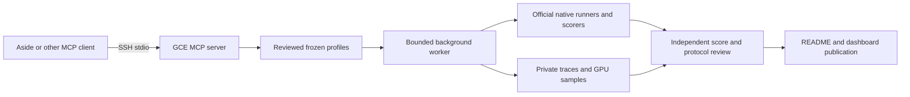

# Gamst Bench MCP

The MCP server exposes **three core benchmark families** for the first evaluation campaign: FastBench, OmniPro and StreamArena. The remaining catalog entries stay available as reference or future profiles. The client can inspect plans locally; benchmark downloads and inference require a matching **GCE VM**. The server uses private stdio, normally over SSH. It does not silently provision a VM, accept billing, or modify the MCP host configuration.



## Tools

- `detect_environment`: detect OS, architecture, Python, NVIDIA and GCloud availability without side effects.
- `plan_environment`: generate reviewable local/GCP setup commands; never executes them.
- `setup_environment`: with `install=true`, installs only the local MCP environment; GCP remains plan-only.
- `list_benchmarks`: list the three core executable families plus reference-only entries.
- `get_benchmark(benchmark_id)`: source-pinned native command recipes and limitations.
- `list_profiles`: operator-installed execution profiles and unresolved setup blockers.
- `plan_evaluation(profile_id)`: frozen profile hash and exact stages; no inference.
- `plan_dataset(profile_id)`: plan the download before the data manifest exists.
- `prepare_dataset(profile_id, profile_sha256)`: on GCE, download the catalog dataset at the pinned revision into a **new** directory and write a file-hash manifest.
- `start_evaluation(profile_id, profile_sha256)`: check GCE project, start a background worker and return a run ID.
- `list_runs`, `get_run`, `cancel_run`, `list_artifacts`, `read_artifact`: persistent run lifecycle and bounded artifact inspection.

The API accepts registered profile IDs, never arbitrary caller-supplied shell commands. A profile is trusted operator configuration and can execute code: review it before enabling. Remote model/tool/judge calls inside native code require explicit endpoint and data-transfer review. Offline HF flags prevent implicit Hugging Face model downloads during evaluation; they are **not a network firewall**.

## Native coverage

1. **FastBench**: baseline and ProactiveFrame full native presets, combined inference and judging. Same VLM/judge servers required; no oracle focus timing.
2. **SPOT Detection**: ABD + PNR inference, then native detection scorer. Full event/response traces retained. Other tasks need separate profiles for partial splits and LLM judging.
3. **OVO**: all 12 native tasks with an offline Qwen2-VL baseline, followed by the official scorer. Online Gamst integration requires the upstream `OVOBenchOnline` model interface. The stale underscore in the upstream score wrapper is corrected to the result directory actually written by `utils/OVOBench.py`.
4. **OmniPro**: separate Probe and Online profiles with their corresponding native scorers. Online preserves native multiple emits. For AV/V-only/A-only comparisons, duplicate the profile with the upstream modality-specific model choice and keep the checkpoint/settings matched; never pool the modes.
5. **StreamArena**: offline RTP/HR/Tool profile and a separate continuous StreamMind driver profile for proactive sessions. Each uses the shared judge. A Gamst agent must implement the upstream `StreamingAgent` interface; StreamMind is not Gamst. Configure agent dependencies, tool access, ASR, and judge before enabling.
6. **StreamingBench**: four task groups, official evaluation and count scripts, explicit 60-second context. Pin/configure the native model loader to downloaded weights. An AV-capable loader is required before an omni score is valid; a vision-only fallback is insufficient.
7. **Inf-Streams-Eval**: direct generation, answer merge, paired scoring and score merge. This avoids the example scripts' hardcoded NFS paths/eight GPUs. Pin original caption prompt, metadata line counts, baseline output and judge. Record any deviation as a separate protocol track.

All recipes were checked against pinned source CLIs. **GPU/model execution has not been validated.** Templates are disabled until dependencies, licenses, datasets, model loaders, judges, paths and output locations are resolved. Native runners differ; software orchestration does not prove an official reproduction.

## Installation and connection

Install only the MCP tooling in the repository. These commands do not download benchmark data or model weights:

```bash
uv venv .venv-mcp --python 3.12
uv pip install --python .venv-mcp/bin/python -r requirements-mcp.txt
./scripts/serve-mcp.sh
```

Without `--config`, catalog tools work and execution has no registered profiles. The server writes protocol messages to stdout; diagnostics go to stderr/files. See `mcp/client.local.example.json` for a client config using the absolute launcher path.

On the GCE VM, install this repository and the MCP environment, then create a **private** deployment config based on `mcp/profiles.example.json`. Install each native benchmark in its own Python/CUDA environment; the MCP environment does not contain models or benchmark dependencies. Set the verified project ID, pinned source/data/model revisions, absolute paths and review flags. Keep tokens in the server process environment and list only their variable names in `secret_env`. Add `HF_TOKEN` there for gated downloads after access is granted. Never commit the private config or tokens.

Use `mcp/client.ssh.example.json` to connect the client to the VM's stdio server. Replace its SSH alias and server/config paths. Configure the SSH alias through your existing authorized GCP access. This repository does not install credentials or bypass SSH/MCP permissions. The server keeps no public listener.

```bash
/srv/gamst-bench/scripts/serve-mcp.sh --config /srv/private/gamst-mcp.json
```

For hosts using TOML MCP settings, the equivalent server entry is:

```toml
[mcp_servers.gamst_bench]
command = "ssh"
args = ["-T", "YOUR_GCE_SSH_ALIAS", "/srv/gamst-bench/scripts/serve-mcp.sh", "--config", "/srv/private/gamst-mcp.json"]
```

## Execution workflow

1. Prepare a native environment and reviewed profile on GCE. Use a new source checkout or commit any required adapter patches; record changed protocol semantics. Set `PATH` to that benchmark's environment. The GCP project ID must match VM metadata.
2. Call `plan_evaluation`. Resolve every blocker. For data preparation, use `plan_dataset` and set `hf_executable` to that environment's installed HF CLI and a new revision-specific destination. `prepare_dataset` downloads only on GCE. Large archives still need authorized extraction on GCE, followed by a new manifest of the actual decoded files used by the runner.
3. Review the manifest for completeness and source/session split leakage. Set `dataset_manifest_sha256` to the canonical digest of the reviewed manifest (using `gamst_bench.contracts.digest`); evaluation refuses subsequent manifest changes. Freeze the final file manifest, model/consumer/adapter checkpoints, prompts, timings and judge. Hashes verify integrity; they do not verify rights, split quality or model-server identity.
4. Run a separately labelled small development profile first. Keep it out of final leaderboard results. Start the frozen full profile using its current hash, then poll `get_run` and inspect artifacts. One worker per run root executes at a time. Clients receive a run ID without waiting for a long evaluation.
5. Inspect every stage's outputs and scorer denominator. Some upstream scorers skip missing records or return exit code zero without a complete evaluation. The MCP therefore reports `execution_finished_review_required`, **never a quality pass**. Cancelled/failed/timeout runs cannot be silently counted as complete.
6. Independently review scores, hardware/settings, failures and accounting before using `import-official` and `npm run results`. Published literature remains separate. MCP does not automatically post to an upstream leaderboard or publish private artifacts.

Workers retain status and outputs after the MCP client disconnects. A host crash may leave a stale heartbeat; the server does not infer completion or signal a reused PID. Inspect GCE/worker state before rerunning. Cancellation is cooperative during preflight/hashing and polled during subprocess execution. Do not delete interrupted run directories.

## Gamst comparison and measurement boundaries

Use separate registered profiles for matched full VLM, Gamst+LLM, Gamst+selective VLM+LLM, periodic VLM and native methods. Native baseline recipes supplied here are **not Gamst model adapters**. Implement/test the appropriate native model or streaming-agent interface, pin its revision, and label modified-protocol profiles `gamst-extension`. Preserve full continuous sessions; the old task-level collector cannot substitute for a native multi-turn driver.

The worker samples host-wide GPU memory/utilization/power every five seconds and records wall-clock durations. These samples include existing model servers and are not per-job attribution. Unknown full cost and stream duration remain null. Event-to-response p50/p95, misses, stale memory, and full cost require timestamped model/consumer/API traces and verified prices; the MCP does not fabricate those metrics from GPU utilization. Gamst's OCR corrections, audio revisions, sensor gaps and memory deletion cases still need separately authored held-out data and review.

The GCP VM, real native runs, Gamst-specific model adapters, gated access, independent annotations and final cost/quality claims remain deployment/evaluation work. Local validation covers MCP protocol, command planning, execution refusal, cancellation, path boundaries and worker state transitions using tiny non-model fixtures only.
